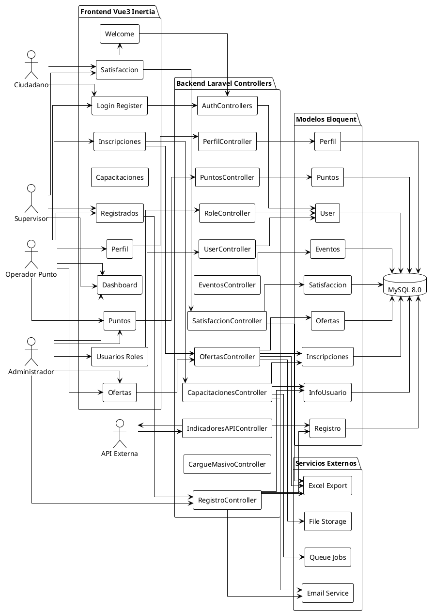
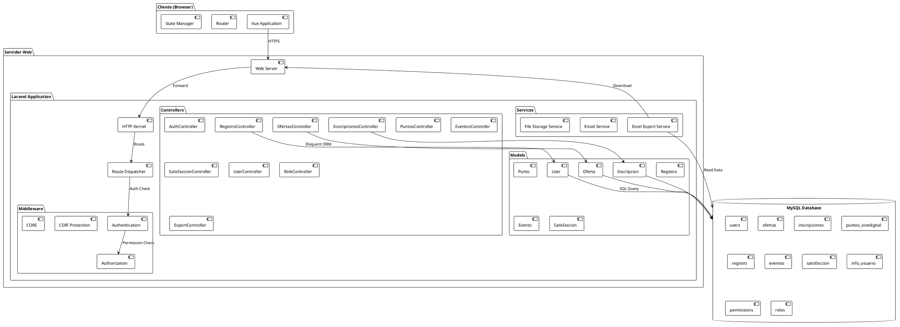
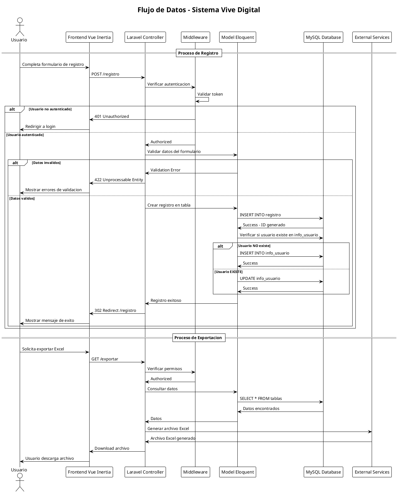
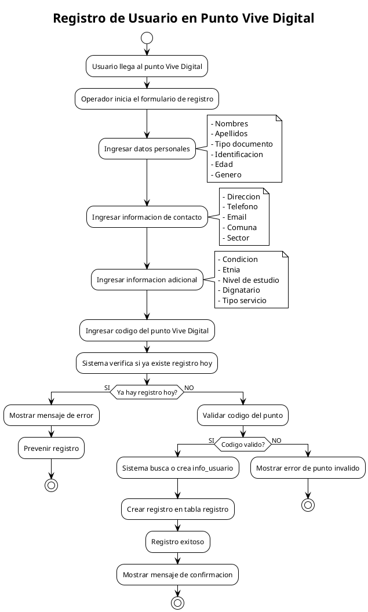
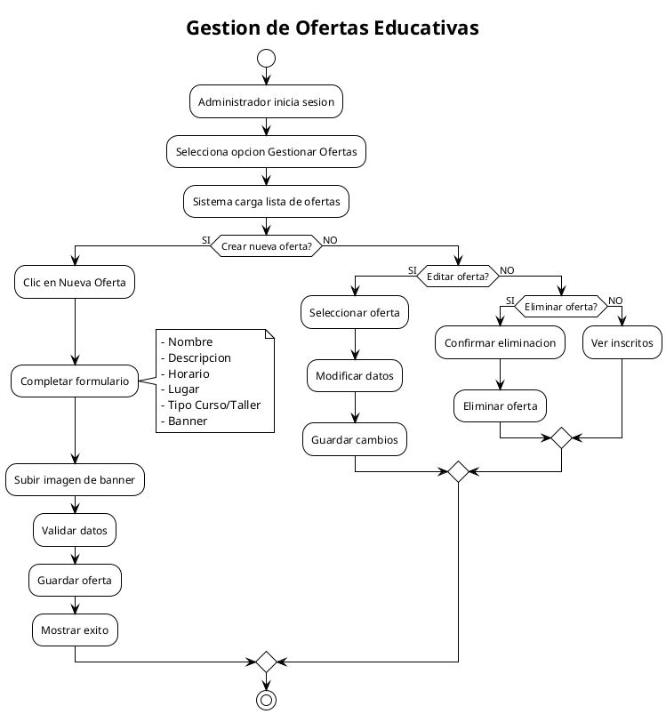
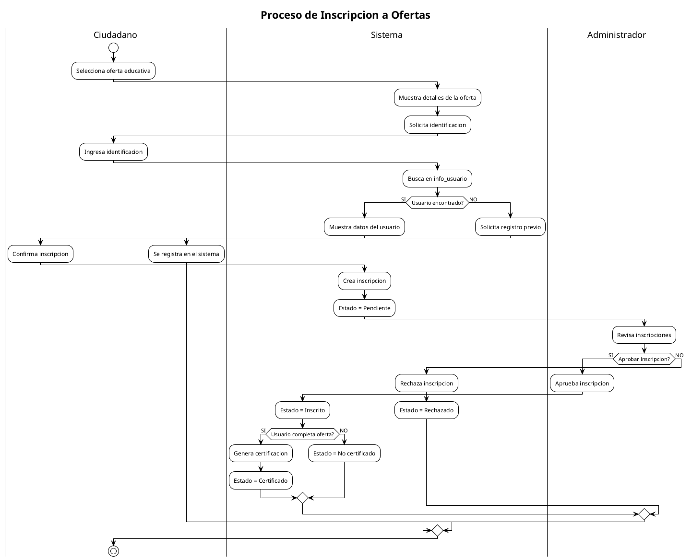
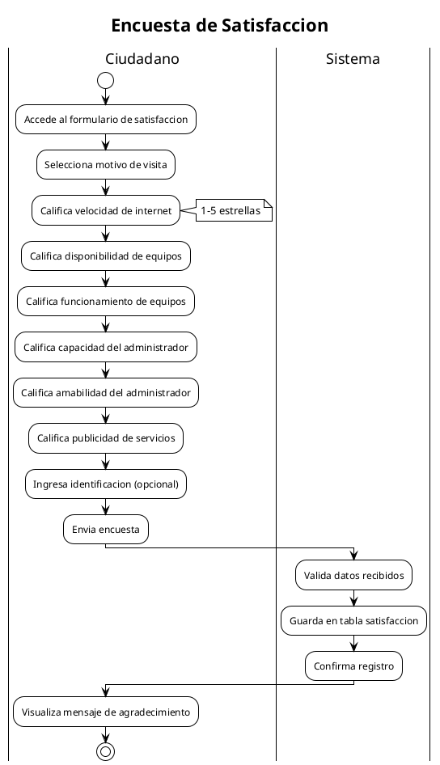
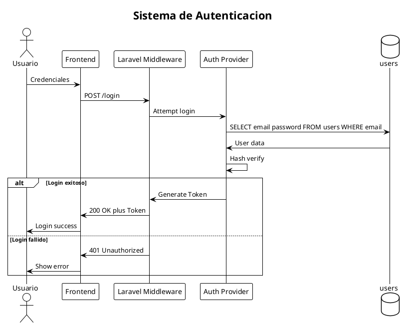
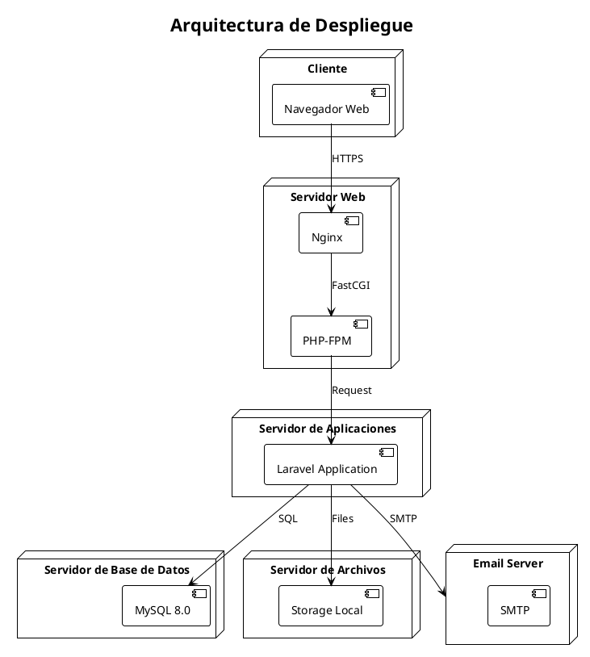

# Documentación Técnica del Proyecto Vive Digital

## Tabla de Contenidos

1. [Introducción](#introducción)
2. [Objetivos](#objetivos)
3. [Alcance del Proyecto](#alcance-del-proyecto)
4. [Arquitectura del Sistema](#arquitectura-del-sistema)
5. [Diagrama de Arquitectura de Alto Nivel](#diagrama-de-arquitectura-de-alto-nivel)
6. [Diagrama de Componentes](#diagrama-de-componentes)
7. [Diagrama de Flujo de Datos](#diagrama-de-flujo-de-datos)
8. [Diagramas de Actividad](#diagramas-de-actividad)
9. [Esquema de Base de Datos](#esquema-de-base-de-datos)
10. [Modelo de Datos Detallado](#modelo-de-datos-detallado)
11. [Estructura del Proyecto](#estructura-del-proyecto)
12. [Tecnologías Utilizadas](#tecnologías-utilizadas)
13. [Módulos del Sistema](#módulos-del-sistema)
14. [API Endpoints](#api-endpoints)
15. [Seguridad y Autenticación](#seguridad-y-autenticación)

---

## Introducción

El presente documento constituye la documentación técnica completa del sistema **Vive Digital**, una plataforma web desarrollada para la gestión integral de los Puntos Vive Digital en Colombia. Este sistema permite la administración de usuarios, ofertas educativas, inscripciones, eventos, encuestas de satisfacción y exportación de datos.

El proyecto está construido sobre el framework Laravel (backend) y Vue.js 3 con Inertia.js (frontend), siguiendo una arquitectura moderna basada en el patrón MVC (Model-View-Controller) con separación clara entre capas de presentación y lógica de negocio.

### Propósito del Sistema

Vive Digital es una iniciativa que busca democratizar el acceso a la tecnología en comunidades vulnerables, ofreciendo espacios dotados de computadores e internet gratuito. El sistema facilita:

- El registro de ciudadanos que visitan los puntos
- La gestión de ofertas educativas y capacitaciones
- El seguimiento de inscripciones y certificaciones
- La medición de satisfacción de los usuarios
- La generación de reportes y estadísticas

---

## Objetivos

### Objetivos Generales

1. **Centralizar la gestión**: Unificar todas las operaciones de los Puntos Vive Digital en una sola plataforma.
2. **Optimizar procesos**: Automatizar el registro de usuarios, inscripciones y seguimiento.
3. **Generar información**: Producir datos estadísticos para la toma de decisiones.
4. **Mejorar la experiencia**: Brindar una interfaz intuitiva para administradores y usuarios.

### Objetivos Específicos

- **OE-001**: Gestionar el registro de ciudadanos con validación de datos demográficos
- **OE-002**: Administrar ofertas educativas (cursos, talleres, capacitaciones)
- **OE-003**: Controlar el proceso de inscripción a ofertas
- **OE-004**: Emitir certificados para usuarios que completan ofertas
- **OE-005**: Recopilar encuestas de satisfacción por punto de atención
- **OE-006**: Gestionar eventos y actividades programadas
- **OE-007**: Exportar datos en formatos Excel para reportes externos
- **OE-008**: Controlar el acceso mediante roles y permisos

---

## Alcance del Proyecto

### Funcionalidades Incluidas

- ✅ Registro de usuarios y ciudadanos
- ✅ Gestión de puntos Vive Digital
- ✅ Administración de ofertas educativas
- ✅ Sistema de inscripciones
- ✅ Certificación de usuarios
- ✅ Encuestas de satisfacción
- ✅ Gestión de eventos
- ✅ Exportación de datos (Excel)
- ✅ Cargue masivo de información
- ✅ Panel de control con estadísticas
- ✅ Autenticación y autorización por roles

### Roles del Sistema

- **Administrador**: Acceso completo a todas las funcionalidades del sistema
- **Supervisor**: Supervisión de múltiples puntos Vive Digital
- **Operador**: Gestión de un punto específico

---

## Arquitectura del Sistema

El sistema Vive Digital sigue una arquitectura de **tres capas** (Three-Tier Architecture):

```
┌─────────────────────────────────────────────────────────────────┐
│                    CAPA DE PRESENTACIÓN                         │
│  ┌─────────────┐  ┌─────────────┐  ┌─────────────┐             │
│  │   Vue 3     │  │  Inertia.js │  │   Tailwind  │             │
│  │  (Frontend) │  │   (SSR)     │  │    (CSS)    │             │
│  └─────────────┘  └─────────────┘  └─────────────┘             │
└─────────────────────────────────────────────────────────────────┘
                              │
                              ▼
┌─────────────────────────────────────────────────────────────────┐
│                    CAPA DE LÓGICA DE NEGOCIO                    │
│  ┌─────────────┐  ┌─────────────┐  ┌─────────────┐             │
│  │ Controllers │  │   Services  │  │   Middleware│             │
│  │   (Laravel) │  │   (Laravel) │  │   (Laravel) │             │
│  └─────────────┘  └─────────────┘  └─────────────┘             │
└─────────────────────────────────────────────────────────────────┘
                              │
                              ▼
┌─────────────────────────────────────────────────────────────────┐
│                    CAPA DE DATOS                                 │
│  ┌─────────────┐  ┌─────────────┐  ┌─────────────┐             │
│  │   Eloquent  │  │  MySQL 8.0  │  │   Redis     │             │
│  │   (ORM)      │  │ (Database)  │  │  (Cache)    │             │
│  └─────────────┘  └─────────────┘  └─────────────┘             │
└─────────────────────────────────────────────────────────────────┘
```

---

## Diagrama de Arquitectura de Alto Nivel

Este diagrama representa la arquitectura completa del sistema Vive Digital, mostrando la interacción entre los diferentes componentes del sistema, desde los actores que interactúan hasta la base de datos.

El flujo de datos sigue un patrón claro: el usuario interactúa con las páginas Vue del frontend, estas envían solicitudes a los controladores Laravel del backend, que procesan la lógica de negocio utilizando los modelos Eloquent y finalmente persisten los datos en MySQL.



### Explicación del Diagrama de Arquitectura

**Flujo Principal de la Aplicación:**

La arquitectura del sistema Vive Digital se estructura en cinco capas principales que trabajan de forma coordinada para procesar las solicitudes de los usuarios. El ciudadano o usuario del sistema inicia su interacción a través de las páginas Vue que conforman el frontend, estas páginas están desarrolladas con Inertia.js y permiten una experiencia de usuario fluida sin necesidad de recargar la página completa.

Cuando el usuario realiza una acción, ya sea registrándose en el sistema, consultando ofertas educativas o evaluando el servicio recibido, la página Vue correspondiente envía una solicitud HTTP al controlador Laravel apropiado en el backend. Por ejemplo, cuando un ciudadano desea inscribirse a una capacitación, la página de Capacitaciones envía la solicitud al CapacitacionesController que contiene toda la lógica necesaria para procesar la inscripción.

El controlador, una vez recibida la solicitud, valida los datos ingresados y utiliza los modelos Eloquent correspondientes para interactuar con la base de datos MySQL. Si el proceso requiere enviar notificaciones por correo electrónico o generar reportes en formato Excel, el controlador hace uso de los servicios externos integrados en el sistema como Maatwebsite para Excel o Laravel Mail para correos electrónicos.

**Actores del Sistema y sus Funciones:**

El Ciudadano representa al usuario final que visita los Puntos Vive Digital. Esta persona puede acceder a la página principal del sistema para visualizar las ofertas educativas disponibles, realizar su registro en el sistema, inscribirse a las capacitaciones de su interés y completar encuestas de satisfacción para evaluar la calidad del servicio recibido. Su interacción principal es con las páginas públicas como Welcome, el formulario de registro y el formulario de satisfacción.

El Operador de Punto es el personal encargado de administrar un punto Vive Digital específico. Este usuario tiene acceso autenticado al sistema y puede gestionar las ofertas educativas de su punto, registrar nuevos ciudadanos que asisten al punto, aprobar o rechazar las inscripciones de los ciudadanos a las ofertas, configurar el perfil de su punto incluyendo redes sociales y descripción, y acceder al panel de control para visualizar estadísticas básicas de su punto.

El Administrador tiene acceso completo a todas las funcionalidades del sistema. Puede gestionar todos los usuarios del sistema, crear y modificar roles y permisos mediante el módulo de roles, administrar todos los puntos Vive Digital sin importar su ubicación, gestionar todas las ofertas educativas del sistema, exportar datos de registros en formato Excel para generar reportes y análisis, y supervisar el funcionamiento general de la plataforma.

El Supervisor cumple un rol de observación y análisis. Puede acceder al panel de control para visualizar estadísticas generales de todos los puntos, supervisar los registros de ciudadanos en diferentes puntos, consultar las encuestas de satisfacción para evaluar el desempeño de los puntos, y generar reportes sobre el funcionamiento de la red de puntos Vive Digital.

La API Externa permite que otros sistemas puedan consumir los indicadores y estadísticas del sistema. Mediante el IndicadoresAPIController, sistemas externos pueden obtener datos sobre registros, inscripciones y otros indicadores importantes para integrarlos con otras plataformas.

**Controladores del Backend y su Funcionalidad:**

Los controladores Laravel son el núcleo del procesamiento de solicitudes. El OfertasController maneja todo lo relacionado con las ofertas educativas incluyendo la creación, edición, eliminación y visualización de ofertas, así como la exportación de datos de ofertas a Excel. El RegistroController procesa el registro de ciudadanos, permitiendo crear nuevos registros, buscar ciudadanos registrados, editar información existente y exportar listados de registrados. El CapacitacionesController gestiona las inscripciones a ofertas, conteniendo la lógica para crear nuevas inscripciones, aprobar pre-inscripciones, rechazar inscripciones y enviar notificaciones por correo electrónico. El PuntosController administra los puntos Vive Digital incluyendo su configuración básica y las inscripciones directas. El EventosController permite crear y gestionar eventos publicados en cada punto. El SatisfaccionController procesa las encuestas de satisfacción, almacena las evaluaciones y permite exportar los resultados. Los controladores UserController y RoleController gestionan la seguridad del sistema mediante la administración de usuarios y roles. El CargueMasivoController facilita la importación masiva de datos desde archivos Excel, reduciendo el tiempo de captura de información.

---

## Diagrama de Componentes

### Diagrama de Componentes del Sistema



### Explicación del Diagrama de Componentes

El diagrama de componentes muestra la estructura interna del sistema desde la perspectiva técnica. El navegador del usuario ejecuta la aplicación Vue que se comunica con el servidor web Nginx. Este servidor redirige las peticiones al kernel HTTP de Laravel, que utiliza el Route Dispatcher para dirigir cada solicitud al controlador apropiado.

Antes de procesar cualquier solicitud, el middleware de autenticación verifica que el usuario esté identificado y el middleware de autorización valida que tenga los permisos necesarios para realizar la acción solicitada. Una vez autorizado, el controlador correspondiente utiliza los modelos Eloquent para interactuar con la base de datos MySQL.

Los servicios externos como la exportación de Excel utilizan los modelos para leer los datos y generar los archivos correspondientes, que luego son enviados al navegador del usuario para su descarga.

---

## Diagrama de Flujo de Datos

### Flujo de Datos Principal



### Explicación del Flujo de Datos

El diagrama de flujo de datos ilustra dos procesos fundamentales del sistema: el registro de ciudadanos y la exportación de datos.

En el proceso de registro, el usuario completa un formulario en la interfaz Vue, que envía los datos al controlador Laravel correspondiente. El middleware de autenticación verifica las credenciales del usuario antes de permitir el acceso. Una vez autorizado, el controlador valida los datos ingresados utilizando las reglas de validación definidas en el modelo. Si la validación es exitosa, se crea un nuevo registro en la tabla de registro y se verifica si el usuario ya existe en la tabla info_usuario para actualizar o crear un nuevo registro según corresponda. Finalmente, se muestra un mensaje de éxito al usuario.

En el proceso de exportación, el usuario solicita exportar datos en formato Excel desde la interfaz. El controlador verifica los permisos del usuario para realizar esta acción, consulta los datos requeridos en la base de datos y utiliza el servicio de exportación de Excel para generar el archivo. El archivo se envía al navegador del usuario para su descarga.

---

## Diagramas de Actividad

### 1. Diagrama de Actividad - Registro de Usuario



### 2. Diagrama de Actividad - Gestion de Ofertas



### 3. Diagrama de Actividad - Proceso de Inscripcion



### 4. Diagrama de Actividad - Encuesta de Satisfaccion



---

## Esquema de Base de Datos

### Diagrama Entidad-Relacion

```plantuml
@startuml
!theme plain
skinparam entityStyle uml2

hide circle
hide methods

entity "users" as users {
    * id : BIGINT PK
    * name : VARCHAR(255)
    * email : VARCHAR(191) UNIQUE
    * estado : ENUM(Activo,Bloqueado)
    * email_verified_at : TIMESTAMP
    * password : VARCHAR(255)
    * remember_token : VARCHAR(100)
    * created_at : TIMESTAMP
    * updated_at : TIMESTAMP
}

entity "model_has_roles" as model_has_roles {
    * role_id : BIGINT FK
    * model_type : VARCHAR(255)
    * model_id : BIGINT FK
}

entity "roles" as roles {
    * id : BIGINT PK
    * name : VARCHAR(125)
    * guard_name : VARCHAR(125)
    * created_at : TIMESTAMP
    * updated_at : TIMESTAMP
}

entity "permissions" as permissions {
    * id : BIGINT PK
    * name : VARCHAR(125)
    * guard_name : VARCHAR(125)
    * created_at : TIMESTAMP
    * updated_at : TIMESTAMP
}

entity "role_has_permissions" as role_has_permissions {
    * permission_id : BIGINT FK
    * role_id : BIGINT FK
}

entity "puntos_vivedigital" as puntos {
    * id : BIGINT PK
    * nombre : VARCHAR(255)
    * direccion : VARCHAR(255)
    * sector : VARCHAR(100)
    * code : VARCHAR(50)
    * identificador_politicas : VARCHAR(100)
    * id_user : BIGINT FK nullable
}

entity "ofertas" as ofertas {
    * id : BIGINT PK
    * nombre : VARCHAR(255)
    * id_puntos : BIGINT FK
    * horario : VARCHAR(100)
    * descripcion : TEXT
    * estado : VARCHAR(50)
    * lugar : VARCHAR(255)
    * banner : VARCHAR(255)
    * tipo : VARCHAR(50)
    * created_at : TIMESTAMP
    * updated_at : TIMESTAMP
}

entity "eventos" as eventos {
    * id : BIGINT PK
    * nombre : VARCHAR(255)
    * id_puntos : BIGINT FK
    * descripcion : TEXT
    * estado : VARCHAR(50)
    * tipo : VARCHAR(50)
    * banner : VARCHAR(255)
    * link : VARCHAR(255)
    * created_at : TIMESTAMP
    * updated_at : TIMESTAMP
}

entity "registro" as registro {
    * id : BIGINT PK
    * nombres : VARCHAR(100)
    * apellidos : VARCHAR(100)
    * edad : INT
    * tipo_documento : VARCHAR(20)
    * identificacion : VARCHAR(20)
    * direccion : VARCHAR(100)
    * sector : VARCHAR(100)
    * comuna : VARCHAR(100)
    * telefono : VARCHAR(15)
    * email : VARCHAR(100)
    * genero : VARCHAR(50)
    * condicion : VARCHAR(100)
    * etnia : VARCHAR(100)
    * nivel_estudio : VARCHAR(100)
    * id_puntos : BIGINT FK
    * tipo_servicio : VARCHAR(100)
    * dignatario : VARCHAR(100)
    * created_at : TIMESTAMP
    * updated_at : TIMESTAMP
}

entity "info_usuario" as info_usuario {
    * id : BIGINT PK
    * nombres : VARCHAR(100)
    * apellidos : VARCHAR(100)
    * edad : INT
    * tipo_documento : VARCHAR(20)
    * identificacion : VARCHAR(20)
    * direccion : VARCHAR(100)
    * sector : VARCHAR(100)
    * comuna : VARCHAR(100)
    * telefono : VARCHAR(15)
    * email : VARCHAR(100)
    * genero : VARCHAR(50)
    * condicion : VARCHAR(100)
    * etnia : VARCHAR(100)
    * nivel_estudio : VARCHAR(100)
    * dignatario : VARCHAR(100)
    * created_at : TIMESTAMP
    * updated_at : TIMESTAMP
}

entity "inscripciones" as inscripciones {
    * id : BIGINT PK
    * id_oferta : BIGINT FK
    * id_info_user : BIGINT FK
    * identificacion : VARCHAR(20)
    * comentario : TEXT
    * estadoProceso : VARCHAR(50)
    * created_at : TIMESTAMP
    * updated_at : TIMESTAMP
}

entity "satisfaccion" as satisfaccion {
    * id : BIGINT PK
    * id_punto : BIGINT FK
    * motivo_visita : VARCHAR(100)
    * velocidad_internet : INT
    * disponibilidad_equipos : INT
    * funcionamiento_equipos : INT
    * capacidad_administrador : INT
    * amabilidad_administrador : INT
    * publicidad_servicios : INT
    * identificacion : VARCHAR(20)
    * nombre : VARCHAR(200)
    * created_at : TIMESTAMP
    * updated_at : TIMESTAMP
}

entity "perfil" as perfil {
    * id : BIGINT PK
    * descripcion : TEXT
    * telefono : VARCHAR(20)
    * celular : VARCHAR(20)
    * email : VARCHAR(100)
    * instagram : VARCHAR(100)
    * facebook : VARCHAR(100)
    * twitter : VARCHAR(100)
    * banner : VARCHAR(255)
    * id_punto : BIGINT FK
    * created_at : TIMESTAMP
    * updated_at : TIMESTAMP
}

entity "informacion_inicial" as informacion_inicial {
    * id : BIGINT PK
    * nombre : VARCHAR(255)
    * id_puntos : BIGINT FK
    * descripcion : TEXT
    * horario : VARCHAR(100)
    * instagram : VARCHAR(100)
    * youtube : VARCHAR(100)
    * facebook : VARCHAR(100)
    * banner : VARCHAR(255)
    * created_at : TIMESTAMP
    * updated_at : TIMESTAMP
}

entity "page_views" as page_views {
    * id : BIGINT PK
    * page : VARCHAR(255)
    * views : INT
    * created_at : TIMESTAMP
    * updated_at : TIMESTAMP
}

users ||--o{ model_has_roles : tiene roles
roles ||--o{ model_has_roles : asignado a
roles ||--o{ role_has_permissions : tiene
permissions ||--o{ role_has_permissions : asignada a

puntos ||--o{ ofertas : tiene
puntos ||--o{ eventos : tiene
puntos ||--o{ registro : registra
puntos ||--o{ satisfaccion : evalua
puntos ||--o{ perfil : posee
puntos ||--o{ informacion_inicial : configura
puntos ||--o{ users : administra

ofertas ||--o{ inscripciones : tiene

info_usuario ||--o{ inscripciones : posee

@enduml
```



---

## Modelo de Datos Detallado

### Tablas Principales

#### 1. Tabla users

Esta tabla almacena los usuarios del sistema que tienen acceso a la plataforma de administración. Cada usuario puede ser asignado a un rol específico que determina sus permisos dentro del sistema.

- **id**: Identificador único del usuario
- **name**: Nombre completo del usuario
- **email**: Correo electrónico único del usuario
- **estado**: Estado de la cuenta, puede ser Activo o Bloqueado
- **email_verified_at**: Fecha de verificación del correo electrónico
- **password**: Contraseña encriptada del usuario
- **remember_token**: Token para recordar la sesión del usuario
- **created_at**: Fecha de creación del registro
- **updated_at**: Fecha de última actualización del registro

#### 2. Tabla puntos_vivedigital

Esta tabla contiene la información de los puntos Vive Digital distribuidos en la ciudad. Cada punto tiene un código único que permite su identificación por parte de los ciudadanos.

- **id**: Identificador único del punto
- **nombre**: Nombre del punto Vive Digital
- **direccion**: Dirección física donde está ubicado el punto
- **sector**: Sector o barrio donde se encuentra el punto
- **code**: Código único de identificación del punto
- **identificador_politicas**: Identificador para políticas específicas
- **id_user**: FK al usuario administrador del punto

#### 3. Tabla ofertas

Esta tabla almacena las ofertas educativas como cursos, talleres y capacitaciones disponibles en cada punto Vive Digital.

- **id**: Identificador único de la oferta
- **nombre**: Nombre de la oferta educativa
- **id_puntos**: FK al punto Vive Digital al que pertenece
- **horario**: Horario de la oferta
- **descripcion**: Descripción detallada de la oferta
- **estado**: Estado de la oferta (Activo, Inactivo)
- **lugar**: Lugar donde se realiza la oferta
- **banner**: Imagen representativa de la oferta
- **tipo**: Tipo de oferta (Curso, Taller, Capacitación)

#### 4. Tabla inscripciones

Esta tabla gestiona las inscripciones de los ciudadanos a las ofertas educativas disponibles.

- **id**: Identificador único de la inscripción
- **id_oferta**: FK a la oferta educativa
- **id_info_user**: FK a la información del usuario
- **identificacion**: Número de identificación del ciudadano
- **comentario**: Comentarios adicionales sobre la inscripción
- **estadoProceso**: Estado del proceso (Inscrito, Certificado, No certificado, Rechazado)

#### 5. Tabla registro

Esta tabla almacena el registro diario de ciudadanos que visitan los puntos Vive Digital. Cada ciudadano solo puede registrarse una vez por día.

- **id**: Identificador único del registro
- **nombres**: Nombres del ciudadano
- **apellidos**: Apellidos del ciudadano
- **edad**: Edad del ciudadano
- **tipo_documento**: Tipo de documento de identificación
- **identificacion**: Número de identificación
- **direccion**: Dirección de residencia
- **sector**: Sector o barrio
- **comuna**: Comuna donde vive
- **telefono**: Teléfono de contacto
- **email**: Correo electrónico
- **genero**: Género del ciudadano
- **condicion**: Condición especial si aplica
- **etnia**: Etnia del ciudadano
- **nivel_estudio**: Nivel educativo
- **id_puntos**: FK al punto Vive Digital
- **tipo_servicio**: Tipo de servicio solicitado
- **dignatario**: Si es dignatario o no

#### 6. Tabla info_usuario

Esta tabla contiene la información demográfica de los ciudadanos que se han registrado en el sistema. A diferencia de la tabla registro, esta tabla no tiene límites de tiempo y almacena la información histórica de todos los ciudadanos.

#### 7. Tabla satisfaccion

Esta tabla almacena las encuestas de satisfacción填 respondidas por los ciudadanos que visitan los puntos.

- **id**: Identificador único de la encuesta
- **id_punto**: FK al punto Vive Digital
- **motivo_visita**: Motivo de la visita al punto
- **velocidad_internet**: Calificación de 1 a 5
- **disponibilidad_equipos**: Calificación de 1 a 5
- **funcionamiento_equipos**: Calificación de 1 a 5
- **capacidad_administrador**: Calificación de 1 a 5
- **amabilidad_administrador**: Calificación de 1 a 5
- **publicidad_servicios**: Calificación de 1 a 5

#### 8. Tabla eventos

Esta tabla gestiona los eventos publicados en cada punto Vive Digital.

- **id**: Identificador único del evento
- **nombre**: Nombre del evento
- **id_puntos**: FK al punto Vive Digital
- **descripcion**: Descripción del evento
- **estado**: Estado del evento
- **tipo**: Tipo de evento
- **banner**: Imagen del evento
- **link**: Enlace externo relacionado

#### 9. Tabla perfil

Esta tabla contiene la configuración del perfil público de cada punto Vive Digital, incluyendo información de contacto y redes sociales.

---

## Estructura del Proyecto

### Directorios Principales

```
vive_digital/
├── app/
│   ├── Console/
│   ├── Events/
│   ├── Exceptions/
│   ├── Exports/
│   ├── Http/
│   │   ├── Controllers/
│   │   ├── Middleware/
│   │   └── Requests/
│   ├── Imports/
│   ├── Jobs/
│   ├── Listeners/
│   ├── Mail/
│   ├── Models/
│   └── Providers/
├── database/
│   ├── factories/
│   ├── migrations/
│   └── seeders/
├── resources/
│   ├── css/
│   ├── js/
│   │   ├── Components/
│   │   ├── Layouts/
│   │   └── Pages/
│   └── views/
├── routes/
├── config/
├── public/
├── storage/
└── tests/
```

### Descripcion de Carpetas Clave

- **app/Http/Controllers**: Contiene todos los controladores que manejan las solicitudes HTTP
- **app/Models**: Modelos Eloquent que representan las tablas de la base de datos
- **database/migrations**: Definición del esquema de la base de datos
- **resources/js/Pages**: Componentes de página Vue utilizados por Inertia
- **resources/js/Components**: Componentes Vue reutilizables en toda la aplicación
- **routes**: Definición de todas las rutas de la aplicación

---

## Tecnologias Utilizadas

### Backend

- **Laravel 10.x**: Framework PHP para el backend
- **PHP 8.1+**: Lenguaje de programación del servidor
- **MySQL 8.0**: Sistema de gestión de base de datos
- **Composer 2.x**: Gestor de dependencias PHP

### Frontend

- **Vue.js 3.x**: Framework JavaScript para el frontend
- **Inertia.js 1.x**: Herramienta de rendering del lado del servidor
- **Tailwind CSS 3.x**: Framework de estilos CSS
- **Vite 5.x**: Herramienta de construcción

### Paquetes Laravel

- **laravel/sanctum**: Autenticación mediante tokens API
- **spatie/laravel-permission**: Gestión de roles y permisos
- **maatwebsite/excel**: Exportación de datos a Excel
- **barryvdh/laravel-dompdf**: Generación de documentos PDF

---

## Modulos del Sistema

### Modulo 1: Autenticacion y Usuarios

Permite el registro de usuarios del sistema, inicio de sesión, recuperación de contraseña y gestión de roles y permisos. Los controladores principales son AuthControllers, UserController y RoleController.

### Modulo 2: Gestion de Puntos

Administra los puntos Vive Digital incluyendo la creación, edición y eliminación de puntos, así como la asociación de usuarios administradores a cada punto. El controlador principal es PuntosController.

### Modulo 3: Ofertas Educativas

Gestiona las ofertas educativas disponibles en cada punto, incluyendo la creación, edición, eliminación y exportación de datos. Los controladores principales son OfertasController y CargueMasivoController.

### Modulo 4: Inscripciones

Controla el proceso de inscripción de ciudadanos a ofertas educativas, incluyendo la aprobación, rechazo y certificación. El controlador principal es CapacitacionesController.

### Modulo 5: Registro de Ciudadanos

Procesa el registro diario de ciudadanos que visitan los puntos, con validación para evitar registros duplicados el mismo día. El controlador principal es RegistroController.

### Modulo 6: Satisfaccion

Recopila y almacena las encuestas de satisfacción填 de los ciudadanos, permitiendo la exportación de resultados para análisis. El controlador principal es SatisfaccionController.

### Modulo 7: Eventos

Gestiona los eventos publicados en cada punto Vive Digital. El controlador principal es EventosController.

---

## API Endpoints

### Rutas API REST

```php
// Autenticacion
POST   /api/login          => UserAuthController@login
POST   /api/logout         => UserAuthController@logout
GET    /api/user           => UserAuthController@user

// Registros
GET    /api/registros      => RegistroController@index

// Indicadores
GET    /api/indicadores    => IndicadoresController@index
```

### Rutas Web Principales

```php
// Publico
GET  /                     => Welcome
GET  /register            => RegisteredUserController@create
POST /registro            => RegistroController@create
GET  /formulario-satisfaccion => SatisfaccionController@create
POST /formulario-satisfaccion => SatisfaccionController@store

// Autenticado
GET  /dashboard           => Dashboard
GET  /perfil              => PerfilController@index
GET  /ofertas             => OfertasController@ofertas
GET  /inscritos           => OfertasController@inscritos
GET  /totalInscritos      => OfertasController@totalInscritos
GET  /registrados         => RegistroController@index
```

---

## Seguridad y Autenticacion

### Sistema de Autenticacion

El sistema utiliza Laravel Sanctum para autenticación API y Laravel Breeze para autenticación web. La seguridad se implementa mediante middleware que verifica la identidad del usuario antes de permitir cualquier acción.



### Roles y Permisos

Se utiliza Spatie Laravel Permission para la gestión de roles y permisos. Los roles principales son Administrador, Supervisor y Operador, cada uno con diferentes niveles de acceso al sistema.

### Middleware de Seguridad

- **auth**: Verifica que el usuario esté autenticado
- **verified**: Confirma que el correo electrónico está verificado
- **role**: Valida que el usuario tenga el rol requerido
- **permission**: Verifica que el usuario tenga el permiso específico
- **csrf**: Protección contra ataques de falsificación de solicitudes
- **cors**: Control de acceso a recursos desde otros dominios

---

## Diagramas Adicionales

### Diagrama de Arquitectura de Despliegue



---

## Anexos

### Glosario de Terminos

- **Punto Vive Digital**: Centro de acceso gratuito a internet
- **Oferta educativa**: Curso, taller o capacitación
- **Inscripcion**: Registro en una oferta educativa
- **Certificacion**: Constancia de finalización
- **Registro**: Captura de datos del ciudadano
- **Satisfaccion**: Encuesta de percepción del servicio

### Referencias

- Laravel Documentation: https://laravel.com/docs
- Vue.js Documentation: https://vuejs.org/
- Inertia.js Documentation: https://inertiajs.com/
- Tailwind CSS: https://tailwindcss.com/
- PlantUML Documentation: https://plantuml.com/

---

## Control de Versiones

- **1.0.0**: Versión inicial del documento
- **1.1.0**: Actualización con nuevos módulos y diagramas corregidos

---

**Documento generado automaticamente**
**Proyecto: Vive Digital**
**Fecha: 2025**
